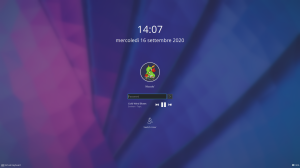

# Adagio lock screen for Plasma 6

This is the Plasma 6 port of the Adagio lock screen. It shows the current desktop wallpaper and clock while idle, then blurs the wallpaper behind the password prompt. The prompt includes Switch User and Sleep; Sleep asks for confirmation.

## Install

Run `./install-lockscreen.sh` from this directory. The script copies the installed Plasma desktop shell into `~/.local/share/plasma/shells/org.kde.plasma.desktop` and replaces its lock screen files with the QML in `contents/lockscreen`. It does not modify system files or change the selected Global Theme. It also syncs the lock screen wallpaper with desktop screen 0.

Run `./install-lockscreen.sh --test` to preview it, `./install-lockscreen.sh --sync-wallpaper` after changing the desktop wallpaper, or `./install-lockscreen.sh --uninstall` to remove the user shell overlay. Reinstall after Plasma updates so the copied shell stays current.

Plasma 6 loads its lock screen from the **Plasma/Shell** package. The Lightly Look and Feel package alone cannot activate this screen, so this component has its own installer. It is not installed by Lightly's CMake build.

Original Adagio theme by IsoaSFlus, inspired by KDE Breeze, kde-plasma-chili, and GNOME lock screen designs. This component is licensed under GPLv3; see [LICENSE](LICENSE).
